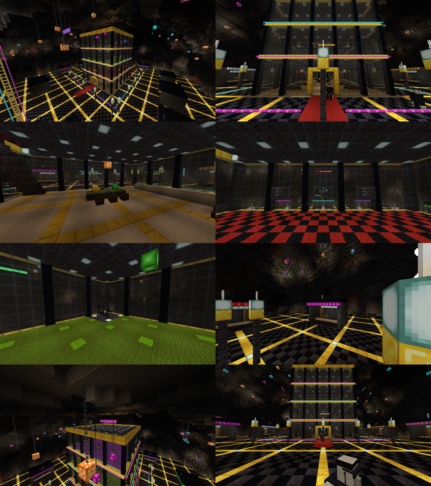
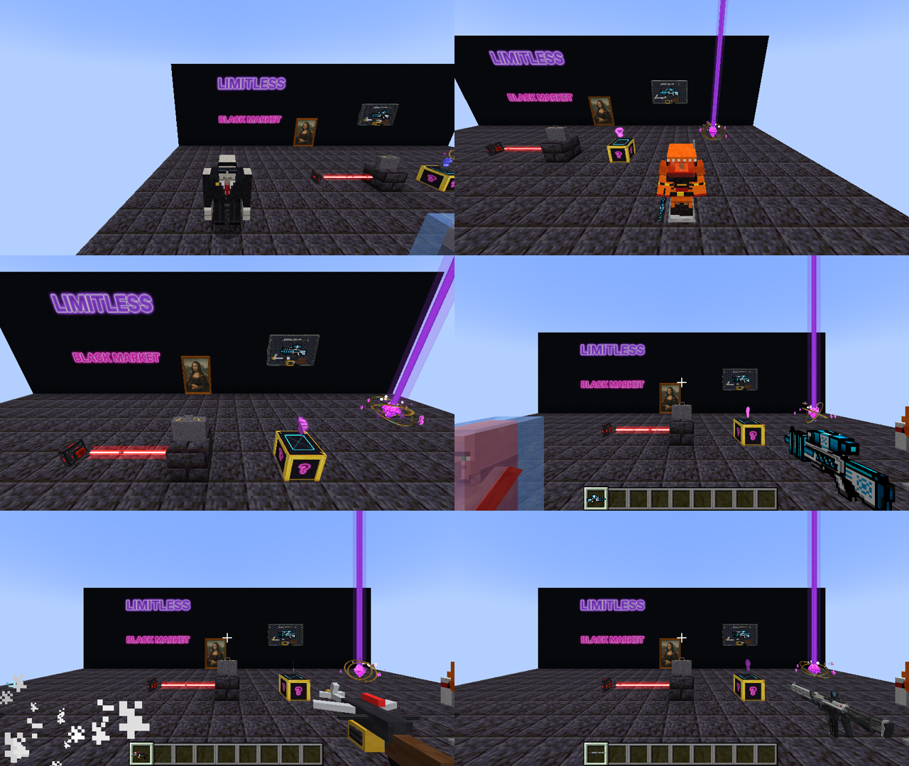
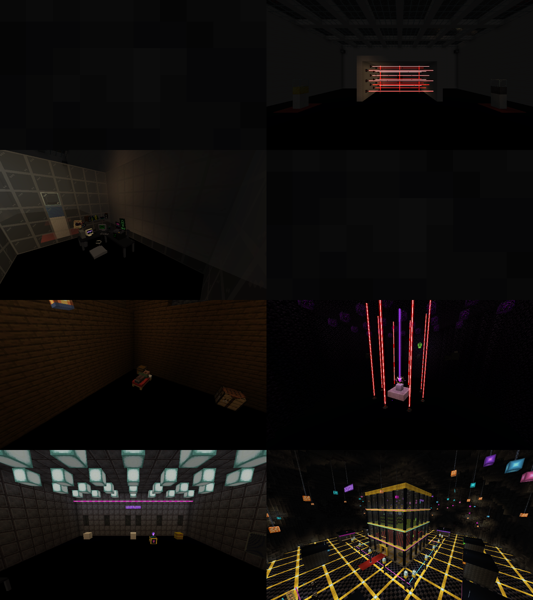
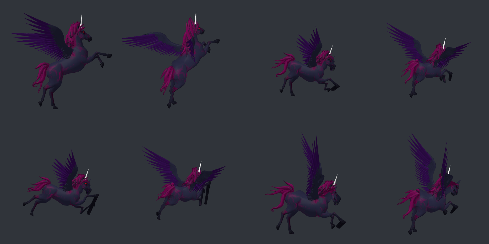
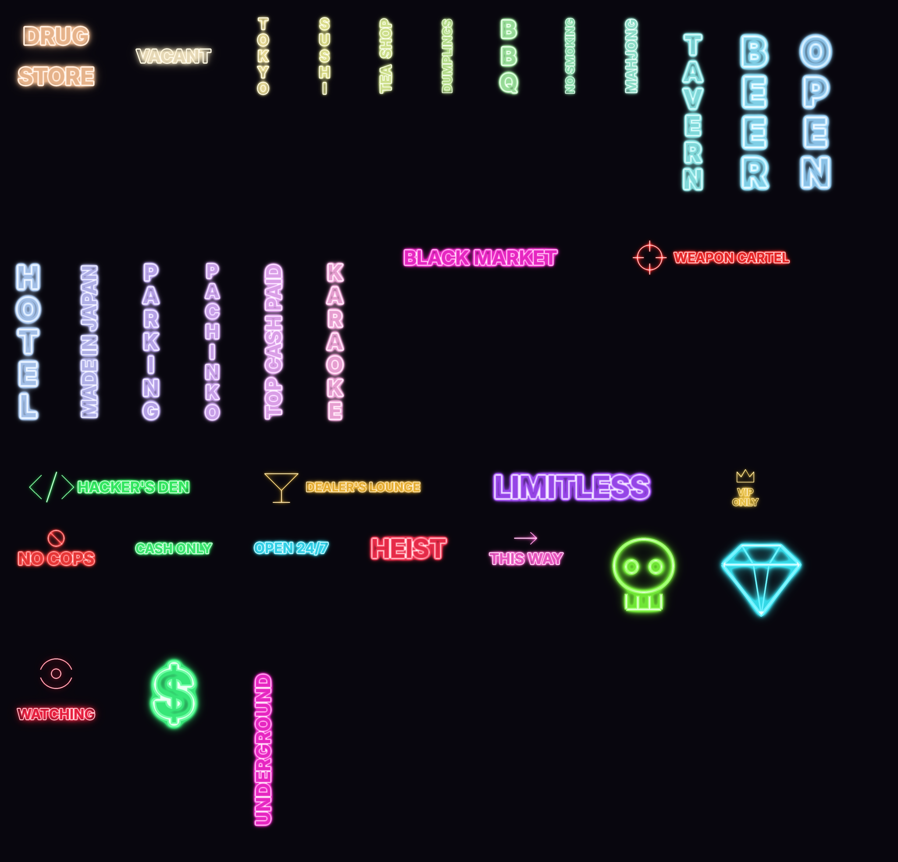

# LimitlessAnant's Black Market Heist — Fabric 1.20.1 mod

An **8K VIP Underground Black Market** heist mod for a cinematic thief video. You steal from three missions
(**Mona Lisa → Legendary Unicorn → Infinity Dragon Core**) to upgrade your bunker from **Gold → Diamond → Netherite**.

| | |
|---|---|
| Minecraft | 1.20.1 |
| Loader | Fabric Loader ≥ 0.15 (built with 0.16.14) |
| Needs | Fabric API (built with 0.92.6+1.20.1) |
| Works with | Iris/Sodium shaders. Everything renders through vanilla render layers, and the emissive parts glow under shaders. |

### Screenshots (real Minecraft 1.20.1, taken by the automated showcase)

| Black Market (cavern, VIP tower, lounge, cartel, hacker den, shops) | Props, gadgets, VIP guard, lava suit, first-person guns |
|---|---|
|  |  |
| **Missions** (museum lasers, security room, Gotiya, dragon vault, bunker) | **Unicorn rig** (idle rearing / gallop / gallop / flight) |
|  |  |

Neon set (translated + new): 

---

## 1. Install & play (2 minutes)

1. Install Fabric Loader for 1.20.1 and put **Fabric API** into `.minecraft/mods`.
2. Build the jar (or use a release jar):
   ```bash
   ./gradlew build
   ```
   then copy `build/libs/limitless-heist-1.0.0.jar` to `.minecraft/mods`.
3. Create a **creative world with cheats**, open the creative tab **"LimitlessAnant's Black Market Heist"**.
4. Stand on the surface and run:
   ```
   /heist build black_market
   ```
   The cavern is built ~58 blocks below you. A neon scaffolding shaft at your feet leads down (sneak to slide down the scaffolding).

### All commands (OP level 2)

| Command | What it builds |
|---|---|
| `/heist build black_market` | The colossal underground market. Its centre is 48 blocks north of you and ~58 blocks down; the secret shaft opens where you stand. |
| `/heist build museum` | **Mission 1**: 8K High-Security Museum (north of you) |
| `/heist build stable` | **Mission 2**: Gotiya's ranch + the Legendary Unicorn |
| `/heist build dragon_vault` | **Mission 3**: the obsidian vault with the Infinity Dragon Core |
| `/heist build bunker_gold` / `bunker_diamond` / `bunker_netherite` | Your bunker. Build the next tier on top of the old one to "upgrade" it on camera. |
| `/heist wanted clear` | Removes the WANTED status from yourself |

Building runs ~60,000 blocks per tick and shows a progress %, so the server never freezes.

---

## 2. The Black Market (concept + generation)

```
 surface ── neon scaffold shaft ("secret entrance", where you ran the command)
              │
 ┌────────────┴──── colossal cavern 120 x 120 x 44, rough deepslate/blackstone walls ─────┐
 │  70 neon chandeliers + 4 giant signs hanging from the ceiling (BLACK MARKET, LIMITLESS…)│
 │  [shop][shop][shop]          ┌──────── VIP TOWER (31x31x36, glass) ─┐  [shop][shop]  │
 │                              │ 4  Penthouse (VIP ONLY, loot boxes)   │                │
 │  [shop]   neon curb ring     │ 3  HACKER'S DEN  (hacker terminal)    │  [shop]        │
 │  [shop]   lamp posts         │ 2  WEAPON CARTEL (racks + rifles)     │  [shop]        │
 │                              │ 1  DEALER'S LOUNGE (briefcase table)  │                │
 │  [shop][shop]                └──────────║ gold door ║───────────────┘  [shop][shop]  │
 │                      red carpet, 2 VIP golem bouncers, the shaft                        │
 └────────────────────────────────────────────────────────────────────────────────────────┘
```

* **Cavern:** a super-ellipse dome with noise, so the walls look natural and rough. A 3-block solid shell is added wherever
  the cave would leak lava, water or gravel. Floor: black checker tiles, a gold grid, and sea-lantern floor lights at every crossing.
* **VIP Tower** (`world/BlackMarketGenerator.java#tower`): glass facade with a black band per floor, black concrete
  frame every 6 blocks, gold floor edges, magenta/cyan neon tubes outside every floor, and a gold doorway with a VIP ONLY sign.
  * **Dealer's Lounge:** a green-felt dealer table with the **briefcase**, gold and emerald "bars", 4 card tables, a marble bar (BEER, CASH ONLY neon) and shroomlight chandeliers.
  * **Weapon Cartel:** red/black carpet, 3 **weapon racks** loaded with **sci-fi assault rifles**, the freeze ray and the grappling gun, plus mystery boxes on pedestals and SKULL and NO COPS neon.
  * **Hacker's Den:** the **hacker terminal setup** in the NE corner, server racks (lit lamps + green glass), and WATCHING and SKULL neon.
  * **Penthouse:** a gold throne, a loot row of mystery boxes, and DIAMOND and $ neon.
  * **Roof:** giant floor-standing **BLACK MARKET** (4x) and **LIMITLESS** (3x) signs.
* **11 upscale shops** around the plaza, each with a deepslate pavilion, a glowing awning edge, a counter with a mystery box, merch shelves and 3 neon signs (the translated Japanese set).
* **Security:** 9 VIP golem bodyguards at the door, the shaft and on the tower floors.

Everything is plain vanilla blocks plus mod props, so you can edit it by hand afterwards.

### Missions

* **Mission 1, Museum** (`MissionGenerators.museum`): a white marble hall with a glass roof, 6 treasure pedestals, and the
  **Mona Lisa** on the north wall behind a **laser corridor** of 15 horizontal and 3 vertical beams, some pulsing. There are two ways to the painting:
  * hack the **terminal in the glass security room** (east side), which turns every laser off for 60 s, or
  * **grappling-hook onto the gallery above the painting** and drop through the hole behind the beams.
  Sneak + right-click the painting to steal it. That triggers the alarm, and every guard hunts you.
* **Mission 2, Stable:** Gotiya (a sleeping nitwit villager) snores in his barn; the **crazy apple is in the chest by his bed**
  ("under his pillow", and he says so when you poke him). Feed the apple to the unicorn to tame it. Gotiya wakes up
  screaming *"MY UNICORN!!! <NAME> YOU THIEF!!!"*, then goes back to sleep 10 s later.
* **Mission 3, Dragon Vault:** an octagonal obsidian/purpur vault, the floating **Infinity Dragon Core** inside a ring of
  pulsing lasers, 4 guards to **freeze** first, and a weapon rack at the entrance holding the **freeze ray** and smoke bombs.

---

## 3. Your provided 3D files: how they were implemented

Minecraft's JSON/Blockbench Java models can only contain **cuboids**. Your Sketchfab files are **triangle meshes**
(the unicorn alone has 50,845 triangles), so the mod has a small **mesh pipeline**:

```
source_models/<name>/scene.gltf ──tools/convert_models.py──► assets/limitlessheist/meshes/<id>.hmesh  (runtime mesh)
                                                          ├─► assets/limitlessheist/textures/mesh/<id>/*.png
                                                          └─► blockbench/<id>/<id>.obj  (editable in Blockbench)
```

`HeistMesh`/`MeshRenderer` (client) draw these meshes through vanilla entity render layers. Flags per material:
**EMISSIVE** (full-bright), **GLOW** (an extra additive bloom pass), **RAINBOW** (animated dark rainbow vertex colour) and
**bones** (per-vertex skinning for animation).

| Your file | In game | Notes |
|---|---|---|
| `Hacker computer terminal setup` | **Hacker Computer Terminal Setup** block (3.6 × 2.3 × 2.7 blocks) | Cut down to the L-desk. Beige restyled to black gunmetal. **Screens are emissive** and glitch while hacking. Copyrighted posters and screens replaced with original heist art (see below). Right-click to **hack**, which turns every laser within 48 blocks off for 60 s. Best placed in a room corner. |
| `Neon cyberpunk signs` | **Neon Cyberpunk Sign** block, 34 designs | The 18 Japanese signs were **translated to English** (table below), plus 16 Black Market designs I made. |
| `briefcase` | **Dealer's Briefcase** block | Carbon-black leather with gold locks. On the dealer table. |
| `Sci-fi assault rifle PBR` | **Sci-Fi Assault Rifle** item (3D) | Display piece; hang it on a rack. |
| `weapon_rack` | **Weapon Rack** wall block (3 × 1.85) | Holds 3 items. Right-click with an item to hang it, empty hand to take it back. The video-game military emblem was replaced with a "Weapon Cartel" crest. The emissive strips glow red. |
| `mona_lisa` | **Mona Lisa** wall block (1.8 × 2.6) | Sneak + right-click (or break it) to steal it, which **triggers the alarm**. |
| `Freeze ray gun` | **Freeze Ray Gun** (3D item) | Shoots an ice bolt: **Slowness X + Frozen** for 10 s, rendered as an **ice statue**. It also freezes water to ice and lava to obsidian. |
| `unicorn_horse_3d` | **Legendary Unicorn** mob | Restyled + rigged, see below. Owner: **Gotiya**. |

### The unicorn edits ("CRUCIAL EDITS")

Done automatically by `tools/convert_models.py → conv_unicorn()`, so they can be re-run:

* **Dark rainbow emission horn:** the horn island is detected automatically. It gets a neutral spiral texture, and at runtime every vertex is
  coloured with a **deep, saturated rainbow scrolling up the horn** (HSV value 0.85, i.e. a *dark* rainbow), drawn full-bright
  with an extra additive halo. Rainbow sparks also drift off it.
* **Sharp, wild, dangerous wings:** every feather (130+ separate pieces) is stretched 1.45× away from the wing root and
  tapered to a **blade point**. The wing membrane is widened, swept back and given a saw-tooth trailing edge. The feathers are black with a violet edge.
* **Sharp, wild hair:** every mane/tail lock is stretched and tapered into a **spike**, and recoloured to black with crimson/violet highlights.
* **Coat:** obsidian with a cold blue sheen. **Eyes:** glowing blood-red.
* **Animation:** 8 bones (wings, 4 legs, tail, head). Idle = the original majestic **rearing** pose. Walking or ridden = the body tilts
  46° into a **gallop** with swinging legs and tucked wings. In the air = **flapping wings**.
  (`client/render/entity/UnicornPose.java`, mirrored in `tools/preview_unicorn_pose.py` for tuning without the game.)
* **Riding:** tame it with the Crazy Apple. No saddle needed. **Look up + W to take off and fly**, release W to glide. No fall damage.

### Neon signs: Japanese → English

| Japanese (your file) | English design |  | Japanese | English |
|---|---|---|---|---|
| 薬 | DRUG STORE | | 居酒屋 | TAVERN |
| 空 | VACANT | | ビール | BEER |
| 東京 | TOKYO | | 営業中 | OPEN |
| 寿司 | SUSHI | | ホテル | HOTEL |
| 茶店 | TEA SHOP | | 日本製 | MADE IN JAPAN |
| 餃子 | DUMPLINGS | | 駐車場 | PARKING |
| 焼肉 | BBQ | | パチンコ | PACHINKO |
| 禁煙 | NO SMOKING | | 高価買取 | TOP CASH PAID |
| 麻雀 | MAHJONG | | カラオケ | KARAOKE |

**New Black Market designs:** BLACK MARKET, WEAPON CARTEL, HACKER'S DEN, DEALER'S LOUNGE, LIMITLESS, VIP ONLY, NO COPS,
CASH ONLY, OPEN 24/7, HEIST, THIS WAY, SKULL, DIAMOND, WATCHING (eye), $, UNDERGROUND. See `docs/neon_signs.png`.

**Using a sign:** place it on a wall, floor (it stands) or ceiling (it hangs).
* **Right-click:** next design (sneak for previous). The action bar shows the Japanese original it translates.
* **Glowstone dust:** flicker on/off.
* **Amethyst shard:** size 1× → 2× → 3× → 4× → 0.5×.

The sign gives off light level 15. There are also **Neon Blocks** and **Neon Tubes** in 10 colours for drawing neon lines on buildings.

---

## 4. Custom models & mechanics made from scratch

| Feature | Model | Mechanics |
|---|---|---|
| **VIP Iron Golem Bodyguard** | Vanilla golem model + an original **black suit skin** painted on the golem UV layout (`textures/entity/vip_guard.png`) + a 3D feature layer: **black wrap-around sunglasses** with a moving glint, a **silk tie**, and a **security earpiece** (`VipAccessoriesModel`, `blockbench/vip_accessories.bbmodel`) | 150 HP, 18 damage. Guards its post (12-block leash) and ignores players until they are **WANTED**, then hunts them. Hitting a guard makes you wanted too. Fights monsters. |
| **Thief Mystery Box** | Blockbench JSON model: black crate, gold posts and lid, glowing neon "?" panels, plus a spinning hologram "?" above it | Break it: a **random gadget** (loot table `data/limitlessheist/loot_tables/blocks/mystery_box.json`) and an **epic burst**: flash, totem particles, end rods, fireworks, a pink/cyan double helix and firework sounds. |
| **Lava Proof Suit (Shark Suit)** | Bulky orange/red space suit: **red glass dome helmet** (translucent), collar ring, antenna, chest console, gills, oxygen backpack with 2 tanks and a **shark fin**, hazard stripes, heavy boots (`LavaSuitModel`, `blockbench/lava_suit.bbmodel`) | Full set: **Fire Resistance**, **super-fast lava swimming** in the direction you look (sprint for more), **clear vision inside lava** (24 blocks instead of ~2), no fire on the screen, and lava bubbles. Netherite-grade armour. |
| **Infinity Dragon Core** | Procedural 3D: faceted crystal, 2 gold rune gyro-rings, 6 orbiting shards | Floats and bobs. The crystal spins one way and the rings tumble on two other axes. Very intense emission: full-bright, an additive glow shell, a pulsing bloom halo, a **purple sky beam** (right-click to toggle) and swirling portal particles. Taking it triggers the alarm. |
| **Crazy Apple** | Dark purple golden-apple sprite with glowing magenta veins + enchant glint | The only thing that tames the unicorn. Eating it gives Regen III, Strength II, Absorption IV and Night Vision. |
| **Grappling Hook Gun** | A **crossbow rebuilt** in Blockbench JSON: stock, angled grip, steel limbs, cable, brass rope spool, red laser sight, and a 3-prong hook on the front that disappears when fired | Shoots a hook (48 blocks). When it bites into a block it **reels you in** at speed, so you can fly over laser grids. Use it again or sneak to let go. No fall damage while reeling. Hitting a mob yanks the mob to you. Renders a steel cable to the gun. |
| **Laser Grid Security** | Emitter block (Blockbench JSON) + a rendered **red laser beam** (white-hot core and 2 additive glow shells) + red particles | The beam goes up to 24 blocks and passes through glass. Touching it **instantly hurts** (3 hearts + fire) and **triggers the alarm**. Redstone power turns it off. Right-click toggles **PULSE** mode (2 s on / 1 s off). Hacker terminal or Hacker USB shuts the grid down. |

**Bonus gadgets** (from the mystery box):
* **Hacker USB:** EMP, lasers within 16 blocks go off for 20 s.
* **Smoke Bomb:** smoke cloud, 10 s invisibility and speed, guards lose you, WANTED cleared.

**The alarm** (`heist/HeistAlarm.java`): on-screen **ALARM!** title, bell, a 12-second wee-woo siren, the WANTED effect (45 s), and
every guard within 64 blocks attacks.

---

## 5. Project structure

```
build.gradle, gradle.properties     Fabric Loom 1.11, MC 1.20.1, yarn build.10, split client/common source sets
src/main/java/com/limitlessanant/heist/
  LimitlessHeist.java               common entrypoint
  registry/   ModBlocks, ModItems, ModBlockEntities, ModEntities, ModEffects, ModItemGroup
  block/      MeshPropBlock (base for 3D-mesh props), HackerTerminalBlock, MonaLisaBlock, WeaponRackBlock,
              NeonSignBlock (+ generated NeonDesigns), NeonStripBlock, MysteryBoxBlock, DragonCoreBlock, LaserEmitterBlock
  blockentity/ synced block entities (neon design/size/flicker, rack items, laser state, hacking progress...)
  entity/     VipGuardEntity, UnicornEntity, GotiyaEntity, FreezeBoltEntity, GrappleHookEntity
  item/       FreezeRayItem, GrapplingGunItem, CrazyAppleItem, LavaSuitArmorItem/Material, HackerUsbItem, SmokeBombItem, AssaultRifleItem
  effect/     FrozenEffect (ice statue), WantedEffect
  heist/      HeistAlarm, HeistEvents (siren, suit), LaserRegistry
  world/      StructureBuilder (tick-sliced builder), Canvas/Local (building DSL),
              BlackMarketGenerator, MissionGenerators, HeistCommands
  mixin/      LivingEntityMixin (lava swimming)
src/client/java/com/limitlessanant/heist/client/
  LimitlessHeistClient.java          client entrypoint (renderers, layers, item renderers, armour renderer)
  mesh/       HeistMesh (.hmesh reader), MeshManager (reload listener), MeshRenderer
  model/      VipAccessoriesModel, LavaSuitModel
  render/     block entity renderers, entity renderers, UnicornPose, FrozenIceFeatureRenderer, LavaSuitArmorRenderer, Fx
  mixin/      BackgroundRendererMixin (lava vision), InGameOverlayRendererMixin (no fire overlay)
  dev/        ShowcaseDirector (automated screenshot tour, off unless HEIST_SHOWCASE=true)
src/main/resources/assets/limitlessheist/   meshes, textures, models, blockstates, lang
src/main/resources/data/limitlessheist/     loot tables
source_models/   your original glTF files (+ license.txt)
blockbench/      editable OBJ exports + .bbmodel projects
tools/           the asset pipeline (Python 3 + numpy + pillow + fast-simplification)
```

### Rebuilding the assets

```bash
python3 -m pip install numpy pillow fast-simplification
```
```bash
python3 tools/gen_textures.py
```
```bash
python3 tools/convert_models.py
```
```bash
python3 tools/gen_assets.py
```

1. `gen_textures.py`: neon signs (+ `NeonDesigns.java`), hacker posters/screens, weapon-rack crest, entity/item/block textures.
2. `convert_models.py`: glTF → `.hmesh` + textures + OBJ (`python3 tools/convert_models.py unicorn` converts one model).
3. `gen_assets.py`: blockstates, models, lang, loot tables, `.bbmodel` files.

---

## 6. Blockbench instructions & texture mapping

### A) Editing the provided meshes (unicorn, hacker setup, rifle, rack, briefcase, Mona Lisa, freeze ray, dragon core)
1. Blockbench → **File → New → Generic Model**, then **File → Import → Import OBJ Model** → `blockbench/<id>/<id>.obj`.
   The textures next to the OBJ load automatically (the `.mtl` maps one material per part).
2. Edit in **Edit mode** (mesh tools: move vertices, extrude, knife, etc.). Units are **Minecraft blocks**; the model's **front faces −Z (north)**.
3. **File → Export → Export OBJ Model** and save as `blockbench/<id>/<id>_edited.obj`.
4. Run `python3 tools/convert_models.py <id>`. If `<id>_edited.obj` exists, it is used instead of the glTF.
5. **Texture mapping:** UVs are kept from the source. To repaint, edit `src/main/resources/assets/limitlessheist/textures/mesh/<id>/*.png`
   (or the source texture plus the converter's recolour step). Material flags (emissive/glow/rainbow) are set per material in
   `convert_models.py` (`HACKER_EMISSIVE`, unicorn groups, ...).
6. Unicorn only: the converter also recomputes the bone weights. If you move the legs or wings a lot, check the pose with
   `python3 tools/preview_unicorn_pose.py out_dir 1 1 0 0 10` and open `out_dir/pose.obj` in Blockbench.

### B) Block / item models made of cuboids (mystery box, laser emitter, grappling gun, neon tubes)
These are **Java Block/Item** models. Open them directly in Blockbench:
**File → Open Model** → `src/main/resources/assets/limitlessheist/models/block/mystery_box.json` (or `models/item/grappling_hook_gun.json`).
* Grappling gun texture: `textures/item/grappling_hook_gun.png` (32×32, 4×4 colour cells: gunmetal, wood, steel, brass,
  rope, laser red, rubber). Elements `hook_*` are the hook head. `grappling_hook_gun_fired.json` is the same model without them,
  and `grappling_hook_head.json` is only the hook (used for the flying hook).
* Export with **File → Export → Export Block/Item Model** over the same file.

### C) Entity models (VIP sunglasses/tie/earpiece, Lava Suit)
Open `blockbench/vip_accessories.bbmodel` or `blockbench/lava_suit.bbmodel` (**Modded Entity** format, box UV).
1. Edit the cubes. Keep the group names (`glasses`, `tie`, `earpiece`; `head`, `body`, `right_arm`, ...).
2. **File → Export → Export Java Entity** → choose **Fabric 1.17+ (Yarn)** mappings, and copy the `cuboid(...)` lines into
   `VipAccessoriesModel.getTexturedModelData()` / `LavaSuitModel.getTexturedModelData()`.
3. **Texture mapping (box UV):** each cube has a UV offset (u, v). Its faces are laid out as
   `[down|up]` on the first row and `[west|north(front)|east|south(back)]` on the second
   (`tools/gen_textures_entities.py → box_faces()`). Paint the front of a cube in the "north" rectangle.
   Golem suit skin: same rule on the vanilla golem layout (head at 0,0, body at 0,40, arms at 60,21 / 60,58, legs at 37,0 / 60,0).

---

## 7. Filming tips

* `F1` hides the HUD. With Iris + any bloom shader (BSL, Complementary), the neon, horn, dragon core and lasers glow for real.
* Neon signs and props render up to 128–160 blocks away; the dragon core beam up to 256.
* For a clean intro shot, run `/heist build black_market`, then fly in through the shaft.
* Freeze-ray guards in Mission 3 first (they become ice statues for 10 s), then grab the core.
* Developer screenshot tour: `HEIST_SHOWCASE=true ./gradlew runClient` creates a world, builds everything and saves
  shots in `run/screenshots/` (`HEIST_SHOWCASE_ONLY=missions` for just the missions). It is a good starting point
  for planning camera angles. Build missions on fairly flat ground; the generators clear 30 blocks of sky above
  themselves, but they don't level hillsides around them.

## Credits
See **[CREDITS.md](CREDITS.md)**. All 8 provided models are CC-BY-4.0, so **put the credit block in your video description**.
